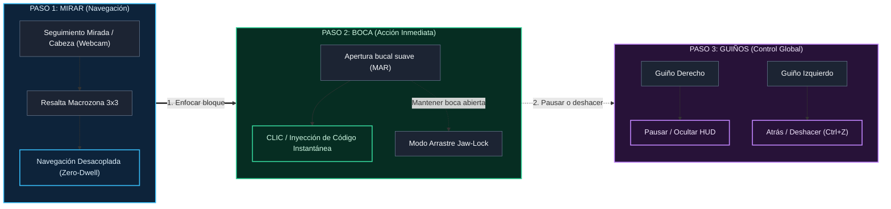

<div align="center">

# IDEye (Motor Vistax L2C)
**El motor de programación Look-To-Code (L2C) para ingeniería de software manos libres y silenciosa**

<p align="right">
  <strong>Idioma:</strong>
  <a href="README.md">English</a> | <b>Español</b>
</p>

[](https://www.python.org/)
[](https://github.com/danicaju/IDEye/releases)
[](https://developers.google.com/mediapipe)
[](https://www.riverbankcomputing.com/software/pyqt/)
[](#-testing-y-qa)
[](LICENSE)

*Escribe código de producción real usando únicamente una webcam estándar, seguimiento ocular híbrido y gestos faciales discretos. Sin manos. Sin comandos de voz. Sin hardware infrarrojo caro.*

[Descargas Rápidas](#-descargas-y-versiones-precompiladas) • [Cómo Funciona](#-cómo-funciona-en-3-pasos) • [Innovaciones](#-innovaciones-principales) • [Inicio Rápido](#-inicio-rápido) • [Controles y Atajos](#-controles-y-atajos-en-tiempo-real) • [Arquitectura](#-arquitectura-del-sistema) • [Hoja de Ruta](#-hoja-de-ruta)

---

</div>

> [!TIP]
> **¿Solo quieres usar IDEye sin programar ni instalar Python?**
>
> Descarga la versión portátil precompilada y la extensión de VS Code directamente desde **[GitHub Releases](https://github.com/danicaju/IDEye/releases)**:
> - **`IDEye-Windows-v0.5.0.zip`** — Aplicación de escritorio lista para usar (descomprimir y ejecutar `IDEye.exe`).
> - **`ideye-vscode-bridge-0.5.0.vsix`** — Extensión compañera para VS Code (arrastrar y soltar en la ventana del editor).

---

## El Problema y Por Qué Existe IDEye

Los desarrolladores que sufren lesiones por esfuerzo repetitivo (RSI), síndrome del túnel carpiano, discapacidades motoras o lesiones temporales encuentran barreras críticas para programar:
1. **Herramientas de voz (Talon, Cursorless):** Requieren vocalización continua, lo que falla en oficinas compartidas, bibliotecas, sesiones nocturnas o para usuarios con dificultades en el habla.
2. **Teclados en pantalla (OptiKey):** Obligan a teclear letra por letra y prácticamente exigen hardware infrarrojo de 300 € a 1.000 € (Tobii) para mitigar el temblor de las webcams.
3. **Controladores de ratón por webcam (Project Gameface, eViacam):** Solo mueven el cursor del sistema operativo y sufren el problema del *Toque de Midas* (fatiga por temporizadores de fijación).

**IDEye (Vistax)** replantea la interacción desde los fundamentos: uniendo un **HUD 3x3 de macrozonas AST**, **seguimiento híbrido cabeza + iris en webcam estándar**, **disparadores inmediatos por gestos faciales sin temporizador**, **puente WebSocket bidireccional con VS Code** y **predicción de contexto sintáctico en vivo**.

### Comparativa con el Estado del Arte

| Característica / Capacidad | Webcam Estándar (0 €) | 100% Silencioso (Sin Voz) | Inyección de Código por AST / Macros | Detección de Variables Locales en Vivo | WebSocket Bidireccional con VS Code | FreeLook 60 Hz y Gaming |
| :--- | :---: | :---: | :---: | :---: | :---: | :---: |
| **Talon Voice / Cursorless** | No | No | Sí | Sí | No | No |
| **OptiKey** | Parcial *(Requiere IR)* | Sí | No *(Carácter a carácter)* | No | No | No |
| **Google Project Gameface** | Sí | Sí | No *(Solo ratón OS)* | No | No | Sí |
| **IDEye (Vistax L2C)** | **Sí** | **Sí** | **Sí (HUD 3x3 Macro)** | **Sí (AST + IA)** | **Sí** | **Sí** |

---

## Cómo Funciona en 3 Pasos



---

## Innovaciones Principales

El sistema se estructura en cuatro pilares arquitectónicos:

### 1. Seguimiento Híbrido Sub-Píxel y Centroide Craneal
La captura pupilar estándar carece de rango dinámico a distancias de escritorio. IDEye fusiona el desplazamiento del iris con el vector de anclaje de la nariz:
$$\mathbf{P}_{raw} = \alpha_{head} \cdot \mathbf{V}_{nose} + (1 - \alpha_{head}) \cdot \mathbf{V}_{iris}$$
Puntos de anclaje craneales ponderados en MediaPipe FaceMesh (`[1, 4, 6, 168, 195, 197]`) combinados con una puerta de histéresis (`STATIC_LOCK_RADIUS=0.0035`, deriva `0.0px`) suprimen el microtemblor en fijaciones sin añadir latencia a las sacadas. Incluye tolerancia a gorras y compensación ocular por CLAHE en baja iluminación.

### 2. Eliminación del Toque de Midas y Gestos Biométricos
La navegación y la activación están completamente desacopladas: mirar solo resalta, jamás acciona. Una apertura breve de la boca (Mouth Aspect Ratio, MAR) ejecuta un clic o inyección instantánea. Mantener la boca abierta activa el modo de arrastre **Jaw-Lock**. Un **umbral dinámico adaptativo de reposo (Anti-Midas)** aprende la apertura natural del usuario en tiempo real, evitando clics fantasma y fatiga por fijación. Los guiños independientes gestionan el retroceso/deshacer (guiño izquierdo) y la pausa del HUD (guiño derecho).

### 3. Puente WebSocket Bidireccional con VS Code y AST en Vivo
`WebSocketBridge` sincroniza diagnósticos del editor, selecciones y árboles sintácticos en tiempo real (`ws://127.0.0.1:54321`). `ContextReader` extrae variables locales, funciones y clases incluso en archivos con errores sintácticos (`ast.walk` + motor regex de respaldo). Dispone de **6 modos de trabajo**: `CODING`, `WRITING` (teclado de letras con predicción de palabras y frases), `TERMINAL_GIT`, `DATA_MATH`, `NAVIGATION` y `FREELOOK_GAMING` (joystick craneal a 60 Hz con zona muerta central).

### 4. HUD PyQt6 No Invasivo, Ergonomía y Multimonitor
La interfaz superpuesta funciona con PyQt6 mediante `WindowDoesNotAcceptFocus` y `WS_EX_TRANSPARENT`, permitiendo que los clics del ratón físico atraviesen el HUD sin robar el foco del teclado ni perder el cursor del editor. Soporta **modo columna Right Dock** (30% de ancho), **Ghost Mode** (atenuación al 15% de opacidad durante la lectura), **traspaso visual entre monitores** y síntesis procedural de sonido sin dependencias de audio externas.

---

## Inicio Rápido

### Descargas y Versiones Precompiladas (Recomendado para Usuarios)
1. **Descargar `IDEye-Windows-v0.5.0.zip`** desde **[GitHub Releases](https://github.com/danicaju/IDEye/releases)** y descomprimirlo.
2. **Ejecutar `IDEye.exe`** (incluye los entornos de ejecución de Python, OpenCV, MediaPipe y PyQt6).
3. **Instalar la extensión en VS Code**: Arrastrar `ideye-vscode-bridge-0.5.0.vsix` dentro de VS Code.
4. **Programar manos libres**: La cámara se calibra automáticamente y se conecta con el editor mediante WebSocket local.

### Instalación para Desarrolladores (Compilar desde Código Fuente)
```bash
# 1. Clonar el repositorio
git clone https://github.com/danicaju/IDEye.git
cd IDEye

# 2. Configurar entorno virtual
python -m venv venv
venv\Scripts\activate      # En Linux/macOS: source venv/bin/activate

# 3. Instalar dependencias e iniciar
pip install -r requirements.txt
python main.py
```

---

## Controles y Atajos en Tiempo Real

### Atajos Esenciales de Uso Diario

| Acción | Entrada / Atajo | Descripción |
| :--- | :--- | :--- |
| **Killswitch de Emergencia** | **`Ctrl+Alt+Q`** | Atajo global del sistema: cierra IDEye al instante desde cualquier aplicación |
| **Reset de Emergencia** | **`Ctrl+Alt+R`** | Restablece los pesos de calibración a los valores seguros por defecto |
| **Modo Pausa / Lectura** | **`Ctrl+Alt+P`** / **Guiño Der.** | Oculta el HUD por completo para leer código sin riesgo de clics accidentales |
| **Snap to Caret** | **`C`** | Micro-recalibración en 1 punto centrando la mirada sobre el cursor del editor |
| **Alternar Columna Derecha** | **`D`** | Cambia entre pantalla completa (100%) y columna lateral (30%, 460px de ancho) |
| **Inyectar / Clic** | **Clic Bucal** | Apertura breve de boca (MAR) para ejecutar clics inmediatos sin temporizador |
| **Arrastrar / Jaw-Lock** | **Boca Sostenida** | Mantener la boca abierta activa el modo arrastre continuo sin fatiga |
| **Deshacer Universal** | **`Z`** / **Guiño Izq.** | Retrocede en los menús o envía un Deshacer (Ctrl+Z) al editor activo |

<details>
<summary><b>Ver todos los 34 atajos avanzados, controles de modo y gaming</b></summary>

<br>

| Tecla | Acción | Descripción |
| :--- | :--- | :--- |
| **`Ctrl+Alt+A`** | **Menús Inteligentes** | Adapta dinámicamente las 9 celdas a firmas de función, bloques try y bucles |
| **`Ctrl+Alt+B`** | **Historial Portapapeles**| Abre las últimas 6 copias en una cuadrícula 3x3 para reinyección inmediata |
| **`Ctrl+Alt+L`** | **Cambiar Lenguaje** | Rota definiciones sintácticas: Python, TypeScript, Rust, C++, Go |
| **`Ctrl+Alt+V`** | **Selector de Modos** | Abre el conmutador de los 6 modos desde cualquier parte del sistema |
| **`Ctrl+Alt+K`** | **Auto-Conmutación** | Activa/desactiva el cambio de modo automático según el contexto de VS Code |
| **`Ctrl+Alt+F`** | **Modo FreeLook** | Control libre del cursor a 60 Hz con imán superior para la barra de comandos |
| **`Scroll Borde`** | **Desplazamiento Web** | Fijar la mirada en el borde superior/inferior durante ~0.3 s para hacer scroll |
| **`Ctrl+Alt+G`** | **Modo Gaming** | Joystick craneal para WASD; guiño izquierdo salta; guiño derecho activa cursor |
| **`Ctrl+Alt+S`** | **Sonido Procedural** | Activa o silencia el feedback auditivo sintetizado |
| **`Ctrl+Alt+H`** | **Ayuda y Gestos** | Abre la guía de atajos, calibración y referencia de gestos faciales |
| **`Ctrl+Alt+T`** | **Modo de Seguimiento** | Conmuta entre algoritmos `HEAD_PRIMARY`, `PURE_IRIS` y `HYBRID` |
| **`Ctrl+Alt+C`** | **Calibración Central** | Mirar al centro de la pantalla y pulsar para reajustar el ancla neutral |
| **`Ctrl+Alt+M`** | **Mini-Monitor** | Muestra/oculta el panel de métricas de seguimiento y cámara en tiempo real |
| **`Ctrl+Alt+N`** | **Traspaso Multimonitor**| Mueve el HUD y los límites de la mirada al siguiente monitor conectado |
| **`Ctrl+Alt+Z`** | **Lente Francotirador** | Activa zoom de precisión x3.5 y cámara lenta en modo FreeLook |
| **`Ctrl+Alt+J`** | **Salto Semántico AST** | Abre el mapa de símbolos 3x3 del archivo activo y teletransporta el cursor |
| **`Ctrl+Alt+I`** | **Lanzador Agéntico** | Abre 6 prompts de ingeniería para el chat de VS Code o la cola local MCP |
| **`Ctrl+Alt+W`** | **Scroll Inercial** | Rueda vertical/horizontal proporcional con zona muerta y frenado suave |
| **`P`** | **Spotlight Mirada** | Abre la paleta de comandos 3x3 accesible por mirada |
| **`O`** | **Cambiar Tema** | Alterna entre Cyber Glass, OLED Black (WCAG AAA) y Solarized Dark |
| **`F2`** | **Mini-Tutorial** | Guía interactiva de incorporación en 3 pasos dentro de la aplicación |
| **Salida Ocular**| **[X SALIR] Manos Libres** | Mirar a `[X SALIR]` arriba a la derecha y hacer clic bucal para diálogo accesible |

</details>

---

## Arquitectura del Sistema

```text
+-------------------------------------------------------------------------+
| CAMERA TRACKER (QThread)                                                |
| Captura OpenCV -> MediaPipe FaceMesh (478 pts) -> Iris + Centroide Cráneo|
+------------------------------------+------------------------------------+
 | pyqtSignal(x, y)                  | pyqtSignal("GESTURE")
 v                                   v
+-------------------------------------------------------------------------+
| PYQT6 NO-FOCUS OVERLAY (GUI Principal)                                  |
| [0: FLUJO] [1: FUNC/CLASE] [2: OPERADORES]                              |
| [3: CURSOR] [4: PAUSA] [5: PALABRAS CLAVE]                              |
| [6: EDICIÓN/DESHACER] [7: ENTER/TAB] [8: PREDICTOR IA]                  |
+------------------------------------+------------------------------------+
 |                                   |
 v                                   v
+-------------------------------+  +--------------------------------------+
| GESTOR DE MODOS & VS CODE     |  | MOTOR DE CONTEXTO E IA (QThread)     |
| PUENTE WEBSOCKET              |  | - AST en vivo + Parser de Símbolos   |
| - CODING / WRITING / TERMINAL |  | - Cliente asíncrono Ollama / OpenAI  |
| - DATA / NAVIGATION / FREELOOK|  | - Respaldo heurístico de latencia 0  |
| - GAMING                      |  |                                      |
+-------------------------------+  +--------------------------------------+
 |                                   |
 v                                   v
+-------------------------------+  +--------------------------------------+
| INYECTOR DE CÓDIGO            |  | MOTOR DE SONIDO PROCEDURAL           |
| - Intercambio atómico en clip |  | - Síntesis WAV con numpy             |
| - Reposicionado de cursor     |  | - winsound asíncrono / caché local   |
+-------------------------------+  +--------------------------------------+
 |
 v
+---------------------------------+
| EDITOR OBJETIVO (VS Code, etc.) |
+---------------------------------+
```

---

## Estructura del Proyecto

```text
IDEye/
├── main.py                          # Punto de entrada (`python main.py`)
├── config.py                        # Configuración central del sistema
├── requirements.txt                 # Dependencias (MediaPipe, PyQt6, OpenCV, numpy)
├── build_app.py                     # Compilador standalone PyInstaller
├── IDEye.bat / IDEye.vbs            # Lanzadores para Windows (consola / silencioso)
├── docs/guia_interactiva.html       # Manual interactivo autónomo offline
├── vscode-extension/                # Extensión oficial de VS Code por WebSocket
├── ideye/
│   ├── core/                        # Seguimiento, biometría, audio y puente WebSocket
│   ├── modes/                       # Motor de 6 modos (Coding, Writing, Gaming...)
│   ├── ui/                          # Overlay PyQt6 transparente, calibración e iconos
│   ├── actions/                     # Extractor AST, predictor de IA e inyector de código
│   └── assets/                      # Iconos vectoriales de alto DPI y datos de predicción
└── tests/                           # 42 suites con 704 tests automatizados (hardware simulado)
```

---

## Testing y QA

IDEye incorpora una batería automatizada con hardware simulado que cubre casos límite matemáticos, integridad de árboles de menús recursivos, tolerancia a fallos sintácticos en el AST y estabilidad de la mirada:

```bash
pytest -q
```
```text
704 passed, 89 subtests in 16.55s
```

> [!NOTE]
> La totalidad de las 704 pruebas se ejecutan de forma desatendida (*headless*) sin necesidad de cámara web física, servidor gráfico ni conexión a internet.

---

## Hoja de Ruta

### Versión Actual (`v0.5.0`)
- [x] Lanzamiento completo en producción: paquete portátil para Windows + extensión de VS Code.
- [x] Motor de 6 modos con detección de contexto automática por WebSocket.
- [x] Umbral dinámico adaptativo Anti-Midas y navegación libre en juegos a 60 Hz.

### Próximos Hitos
- [ ] Backend nativo para Linux Wayland (soporte de `wlr-layer-shell`).
- [ ] Binario universal empaquetado para macOS Apple Silicon.
- [ ] Aceleración de modelos pupilares cuantizados en local con ONNX Runtime.

<details>
<summary><b>Historial de Fases de Ingeniería Completadas (Fases 1 a 12.1)</b></summary>

<br>

- [x] **Fase 1:** Seguimiento híbrido iris + cabeza con suavizado EMA y disparo bucal MAR.
- [x] **Fase 2:** Overlay transparente PyQt6 con `WindowDoesNotAcceptFocus` y calibración JSON en 5 puntos.
- [x] **Fase 3:** Árboles sintácticos 3x3 e inyección atómica de código con offsets de cursor.
- [x] **Fase 4:** Extracción de símbolos AST/Regex y predicción asíncrona por IA y heurística.
- [x] **Fase 5:** Soporte multisintaxis (TypeScript, Rust, C++, Go) y extensión WebSocket nativa para VS Code.
- [x] **Fase 6:** Motor de 6 modos (Coding, Writing, Terminal, Data, Navigation, FreeLook/Gaming).
- [x] **Fase 6.5 - 6.6:** HUD Glass & Focus, iconos Lucide de alto DPI y maquetación de ayuda.
- [x] **Fase 7 - 7.9:** Audio procedural numpy, FreeLook 60 Hz, arrastre Jaw-Lock y centroide craneal sub-píxel.
- [x] **Fase 8.1 - 8.4:** Ajustes de usuario persistentes, creador de macros, traspaso multimonitor y matriz CI.
- [x] **Fase 9 - 9.6:** Historial de portapapeles, enrutamiento por ventana activa, auto-fix de errores y Health Guard.
- [x] **Fase 10 - 11:** CLAHE en baja iluminación, salto semántico AST, perfiles de juego y scroll inercial.
- [x] **Fase 12 - 12.1:** Taxonomía semántica profunda, tutorial interactivo de onboarding y motor adaptativo Anti-Midas.

</details>

---

## Privacidad, Seguridad y Avisos Legales

- **Procesamiento Biométrico 100% Local**: Todos los fotogramas de la cámara y las referencias faciales 3D se procesan exclusivamente en memoria RAM volátil local. IDEye nunca graba, almacena ni transmite datos biométricos por ninguna red.
- **Aviso Ergonómico**: IDEye es una herramienta de productividad asistiva, no un dispositivo médico certificado. Se recomienda tomar descansos periódicos para prevenir fatiga cervical o mandibular.
- **Aviso para Juegos Online**: El modo Gaming utiliza inyección sintética a nivel de sistema operativo (`Win32 API` / `pynput`) con fines de accesibilidad. Compruebe la compatibilidad antes de usarlo en títulos competitivos multijugador con sistemas antitrampas a nivel de kernel.

---

## Contribuciones y Licencia

IDEye se distribuye bajo los términos de la licencia **GNU Affero General Public License v3.0 (AGPL-3.0-or-later)**. Cualquier modificación, redistribución o despliegue como servicio en red debe permanecer con código abierto bajo esta misma licencia.

<div align="center">
  <sub>Desarrollado por <b>Daniel Casado Juan</b> &middot; Universitat de les Illes Balears (UIB)</sub>
</div>
