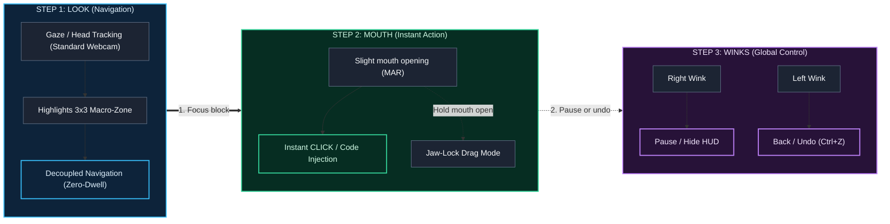

<div align="center">

# IDEye (Vistax L2C Engine)
**The Look-To-Code (L2C) Engine for Hands-Free, Silent Software Engineering**

[](README.md)
[](README.es.md)

[](https://www.python.org/)
[](https://github.com/danicaju/IDEye/releases)
[](https://developers.google.com/mediapipe)
[](https://www.riverbankcomputing.com/software/pyqt/)
[](#-testing--qa)
[](https://opensource.org/licenses/MIT)

*Write real production code using only a standard webcam, hybrid gaze tracking, and discrete facial gestures. No hands. No voice commands. No expensive infrared hardware.*

[Pre-Built Releases](#-pre-built-releases--quick-downloads) • [Quick Start](#-quick-start) • [How It Works](#-how-it-works-3-step-hands-free-interaction) • [Explore Architecture](#-system-architecture) • [Core Innovations](#-core-innovations) • [Controls & Shortcuts](#-runtime-controls--shortcuts) • [Roadmap](#-roadmap)

---

<!-- TODO: Replace with a 15-second GIF recorded with OBS showing you coding in VS Code with the HUD overlay -->


</div>
> [!TIP]
> **Just want to use IDEye without installing Python or touching a terminal?**
> Download the pre-compiled portable bundle and the official VS Code companion extension directly from **[GitHub Releases](https://github.com/danicaju/IDEye/releases)**:
> * **`IDEye-Windows-v0.5.0.zip`** — Standalone Windows desktop app (unzip and double-click `IDEye.exe`).
> * **`ideye-vscode-bridge-0.5.0.vsix`** — Native VS Code extension (drag & drop directly into your VS Code window).


## The Problem & Why IDEye Exists

Developers experiencing severe RSI, carpal tunnel, motor disabilities, or temporary injuries face a major barrier when trying to write code:
1. **Voice-coding tools (Talon, Cursorless)** are amazing, but require constant vocalization—failing in shared offices, libraries, late-night sessions, or for users with speech impairments.
2. **On-screen keyboards (OptiKey)** force letter-by-letter typing (`f`-`o`-`r`-`space`...) and practically require $300–$1,000 specialized infrared eye-trackers (Tobii) because standard webcams suffer from a 100–150px dispersion jitter.
3. **Webcam mouse drivers (Project Gameface, eViacam)** only move the OS cursor; clicking tiny 15px IDE symbols or suffering from the *"Midas Touch" problem* (dwell-time clicking fatigue) makes programming agonizingly slow.

**IDEye (Vistax)** solves this by rethinking the programming interface from first principles: combining a **3x3 Macro-Zone AST HUD**, **hybrid head+iris webcam tracking**, **instant zero-dwell facial-gesture triggers**, **bidirectional VS Code WebSocket integration**, and **live AST/LLM context prediction**.

### State-of-the-Art Comparison

| Feature / Tool | Standard Webcam ($0) | 100% Silent (No Voice) | AST / Macro Code Injection | Live Local Variable Awareness | Bidirectional VS Code WebSocket + Auto-Context Modes + 60 Hz FreeLook & Gaming |
| :--- | :---: | :---: | :---: | :---: | :---: |
| **Talon Voice / Cursorless** | No | No | Yes | Yes | No |
| **OptiKey** | Partial *(IR Recommended)* | Yes | No *(Char-by-char)* | No | No |
| **Google Project Gameface** | Yes | Yes | No *(Mouse driver only)* | No | No |
| **IDEye (Vistax L2C)** | **Yes** | **Yes** | **Yes (3x3 Macro-HUD)** | **Yes (AST + AI)** | **Yes** |

---

### How It Works: 3-Step Hands-Free Interaction




---

## Core Innovations

### 1. Sub-Pixel Cranial Centroid & Multi-Mode Tracking
Standard webcam pupil tracking lacks dynamic range at normal monitor distances. IDEye fuses the normalized iris offset with the 3D nose-tip anchor vector:

$$\mathbf{P}_{raw} = \alpha_{head} \cdot \mathbf{V}_{nose} + (1 - \alpha_{head}) \cdot \mathbf{V}_{iris}$$

$$\mathbf{S}_t = \gamma \cdot \mathbf{P}_{raw} + (1 - \gamma) \cdot \mathbf{S}_{t-1}$$

Where $\alpha_{head} \approx 0.60$ provides macro stability across screen corners and $1 - \alpha_{head} \approx 0.40$ allows fast micro-adjustments with the eyes.

For sub-pixel stability, IDEye computes a cranial centroid from MediaPipe FaceMesh landmarks `[1,4,6,168,195,197]` with higher weights on the stable anchors `6`, `168`, and `197`. A hysteresis gate (`STATIC_LOCK_RADIUS=0.0035`, `STATIC_BREAKOUT_RADIUS=0.0085`, 3-frame confirmation, `0.0px` drift) suppresses micro-tremor during fixations without adding lag to saccades. Three tracking modes are provided:
* **`HEAD_PRIMARY`** — default smooth head-weighted tracking.
* **`PURE_IRIS`** — median-of-5 iris samples plus orbital multi-anchor roll compensation for pure eye control.
* **`HYBRID`** — fuses head and iris signals with an adaptive saccade coefficient ramping `0.08 -> 0.55` for fast, stable transitions.

### 2. Zero-Dwell Midas Elimination + Jaw-Lock Gestures
Navigation and activation are fully decoupled: looking only highlights, never clicks. A short mouth opening performs an instant click/inject, while a held open mouth above your adaptive resting-MAR threshold enters **Jaw-Lock** drag mode. No dwell timers means no accidental Midas clicks while reading.

### 3. 6-Mode Strategy Engine + WebSocket Auto-Switch
The `ModeManager` hosts six specialized modes - `CODING_MODE`, `WRITING_MODE`, `TERMINAL_GIT_MODE`, `DATA_MATH_MODE`, `NAVIGATION_READ_MODE`, and `FREELOOK_GAMING_MODE` - and can switch automatically based on VS Code context received over the bidirectional WebSocket bridge. FreeLook delivers smooth 60 Hz camera/look control; Gaming uses a **head-joystick with a central deadzone** for WASD movement, while a right wink toggles a menu cursor for in-game buttons. Writing combines a gaze-friendly **letter keyboard** with a **Predictive Word & Phrase Engine** that suggests whole words and phrases as you type.

Delimiter snippets leave the caret after the closing pair, so a typed name plus `()` becomes `func()` and the next `:` lands correctly in Google Docs or any external editor. FreeLook also releases a stuck Jaw-Lock after two seconds and recenters safely when the face is lost.

Wink detection now learns per-eye EAR baselines, rejects bilateral blinks, far faces, extreme roll/yaw and twitch closures, and exposes hold, cooldown, margin and distance settings in user_settings.json.

### 4. Smart Prefix Deduplication
The writing pipeline deduplicates repeated prefix strokes: `h+hola` becomes `ola`, and `h+Hola` becomes a backspace followed by `Hola`. It tracks spaces, punctuation, arrow keys, and backspace state, and works identically over the VS Code WebSocket bridge. When a delimiter pair follows a typed name, the cursor lands after the pair (`func` + `()` -> `func()`); at an empty position the pair keeps its centered cursor.

### 5. Glass & Focus HUD + High-DPI Lucide + Procedural Audio
The HUD renders Glass and Focus panels with high-DPI Lucide/SVG icons. Sound feedback is synthesized procedurally with `numpy` and cached as small WAV files under `tempfile.gettempdir()/ideye_audio_cache`; playback uses the native async `winsound` backend, so the bundle carries no external audio assets and remains fully offline.

### 6. Fault-Tolerant Live AST + Async AI Predictor
Half-written code rarely compiles. `ContextReader` combines Python's native `ast.walk()` with a line-ordered regex fallback engine to extract local variables, function arguments, and classes from your active file — even when a `SyntaxError` is present. It feeds them into an asynchronous worker (`Ollama` / OpenAI API / Local Heuristics) to populate one-click completions while preserving emergency Pause and Back buttons.

### 7. Non-Intrusive `WindowDoesNotAcceptFocus` HUD + Calibration
Built with `PyQt6`, the transparent overlay stays on top of VS Code, PyCharm, or any IDE using `Qt.WindowType.WindowDoesNotAcceptFocus` and native `WS_EX_TRANSPARENT`. Your editor never loses keyboard focus or cursor blinking, and physical mouse clicks pass seamlessly through the transparent grid to the code beneath. The 5-point visual calibration wizard stores the mapping in `calibration_profile.json`.

### 8. Bidirectional VS Code Bridge + Multilingual Menus
The `WebSocketBridge` exchanges editor state, diagnostics, and selection info with the VS Code extension in real time, enabling context-aware mode switching and snippet injection. Syntax trees are available in multiple languages, including a Spanish common-word dictionary and localized menu labels.

### 9. Clipboard Time-Machine & OS Foreground Intelligence
`ClipboardHistory` keeps the six most recent user copies in a 3x3 HUD grid and excludes IDEye's own atomic writes, so re-injection never pollutes the history. `WindowWatcher` polls the foreground window every 500 ms, debounces transient focus changes, and routes games, terminals, writing apps, browsers and IDEs using configurable process/title lists. `TelemetryManager` records mouth clicks, injected characters, keystrokes saved, efficiency ratio and per-cell heatmaps into `telemetry_stats.json`.

### 10. Multi-Monitor Handover & Per-Monitor Calibration
`ScreenManager` moves the HUD and debug panel between displays, rebinds normalized gaze bounds per monitor, and supports manual `Ctrl+Alt+N` handover plus automatic bezel crossing after a sustained head-yaw gesture. Calibration profiles store the screen aspect ratio and a per-monitor key under `calibration_profiles/`, so 1080p, 4K and ultrawide layouts keep their own mapping.

### 11. Interactive Game Manual (Living Documentation)

`docs/guia_interactiva.html` is a self-contained, offline "Nintendo Game Manual meets Cyber-Glass" guide: five tabbed pages, illustrated action cards with inline SVG, a live 3x3 mode simulator, a shortcut cheatsheet and A4 landscape PDF export. Open it from the **Abrir Manual Interactivo** button in the debug panel or the help modal. Its single source of truth is `ideye/core/guide_catalog.py`, regenerated with `generate_interactive_guide()`.

### 12. Live Diagnostics, Health Guard & Micro-Gestures

The VS Code extension streams active-line errors and warnings over WebSocket. `DiagnosticsFixer` generates imports, missing colons, delimiter closures, indentation repairs and AI suggestions in a 3x3 Auto-Fix menu. `HealthGuard` warns after 28 s without blinking or when eye distance exceeds 138% of baseline. Optional micro-gestures open Auto-Fix with a brow raise and indent/outdent with a head tilt. The header and favicon embed the official app icon as a base64 data URI.

---

## System Architecture

```text
+-------------------------------------------------------------------------+
| CAMERA TRACKER (QThread)                                                |
| OpenCV Capture -> MediaPipe FaceMesh (468 pts) -> Iris + Rigid Cranial Centroid |
+------------------------------------+------------------------------------+
 | pyqtSignal(x, y)                  | pyqtSignal("GESTURE")
 v                                   v
+-------------------------------------------------------------------------+
| PYQT6 NO-FOCUS OVERLAY (Main GUI)                                       |
| [0: FLOW] [1: FUNC/CLASS] [2: OPERATORS]                                |
| [3: CURSOR] [4: PAUSE] [5: KEYWORDS]                            |
| [6: EDIT/UNDO] [7: ENTER/TAB] [8: AI PREDICTOR]                         |
+------------------------------------+------------------------------------+
 |                                   |
 v                                   v
+-------------------------------+  +--------------------------------------+
| MODE MANAGER & VS CODE        |  | CONTEXT & AI ENGINE (QThread)        |
| WEBSOCKET BRIDGE              |  | - Live AST + Regex Symbol Parse      |
| - CODING / WRITING / TERMINAL |  | - Async Ollama / OpenAI Client       |
| - DATA / NAVIGATION / FREELOOK|  | - Zero-Latency Heuristic Backup      |
| - GAMING                      |  |                                      |
+-------------------------------+  +--------------------------------------+
 |                                   |
 v                                   v
+-------------------------------+  +--------------------------------------+
| CODE INJECTOR ENGINE          |  | PROCEDURAL SOUND ENGINE              |
| - Clipboard Atomic Swap       |  | - numpy WAV synthesis                |
| - Auto Cursor Offset Reposition|  | - temp cache + async winsound        |
| - Sticky vs. Auto-Return Nodes|  |                                      |
+-------------------------------+  +--------------------------------------+
 |                                   |
 v                                   v
+-------------------------------------------------------------------------+
| OS MOUSE & GAMING CONTROLLER                                            |
| - SetCursorPos gaze cursor    | - Adaptive Jaw-Lock drag                 |
| - Head-joystick WASD / jump  | - FreeLook 60 Hz / right-wink cursor    |
+-------------------------------+-----------------------------------------+
 |
 v
+---------------------------------+
| TARGET IDE (VS Code, etc.)      |
+---------------------------------+
```

---

## Quick Start

### Pre-Built Releases & Quick Downloads (Recommended for End-Users)

No Python installation, compiler, Git, or terminal commands needed:

1. **Download `IDEye-Windows-v0.5.0.zip`** from **[GitHub Releases](https://github.com/danicaju/IDEye/releases)** and extract it anywhere on your PC.
2. **Launch `IDEye.exe`**: Contains bundled Python, OpenCV, MediaPipe, and PyQt6 runtimes.
3. **Install the Companion VS Code Extension**: Drag `ideye-vscode-bridge-0.5.0.vsix` into VS Code, or install via Extensions view (`Ctrl+Shift+X` ➔ `...` ➔ *Install from VSIX...*).
4. **Code hands-free**: Your webcam calibrates automatically and pairs with VS Code over local WebSocket (`ws://127.0.0.1:54321`).

---

### Developer Installation (Build from Source)

### Prerequisites
* **Python 3.10+** (Python 3.12 recommended)
* A standard webcam (720p/30fps or higher)
* *Optional:* [Ollama](https://ollama.com/) installed locally (`ollama run qwen2.5-coder:1.5b` or `codellama`) for offline neural line completions.

### Installation

```bash
# 1. Clone the repository
git clone https://github.com/danicaju/IDEye.git
cd IDEye

# 2. Create and activate a virtual environment
python -m venv venv
# On Windows:
venv\Scripts\activate
# On Linux/macOS:
source venv/bin/activate

# 3. Install dependencies
pip install -r requirements.txt

# 4. Launch IDEye
python main.py
```

### Desktop Application Launchers

IDEye includes native Windows desktop launchers with custom high-DPI branding:

* **Desktop Shortcut (`IDEye.lnk`)**: Direct double-clickable icon on your Windows Desktop with the official `{ IDEye }` branding.
* **Silent Launcher (`IDEye.vbs`)**: Launches IDEye immediately with zero command-line console flash.
* **Batch Launcher (`IDEye.bat`)**: Quick launcher for standard execution.
* **Debug Launcher (`IDEye_debug.bat`)**: Launches with live terminal output for parameter tuning and tracking metrics.
* **Standalone Native Executable (`build_app.py`)**: Compiles IDEye into a self-contained `dist/IDEye/IDEye.exe` with bundled MediaPipe, PyQt6, and asset models.

### CLI Arguments

```bash
python main.py # Standard launch with camera & saved calibration
python main.py --recalibrate # Force the 5-point visual calibration wizard on startup
python main.py --camera synthetic # Run headlessly with synthetic face landmarks (for testing/demo)
```

### 5-Point Quick Calibration
On first launch (or with `--recalibrate`), IDEye launches the **5-Point Visual Calibration Screen**:
1. Look at the glowing target in the **Center** and slightly open your mouth.
2. Repeat for the **4 screen corners** (Top-Left, Top-Right, Bottom-Left, Bottom-Right).
3. The bilinear mapping matrix is calculated and saved to `calibration_profile.json`. Open VS Code, place your cursor in any `.py` file, and start coding!
4. **Step 6 (MAR):** open and close your mouth **3 complete times**. The step never advances by timeout: all 3 dots must turn green and the threshold is confirmed 650 ms after 3/3. Use `ESC` or `Space` only for an explicit manual skip.

> Calibration is stored with the screen aspect ratio. Switching to a display with a very different aspect ratio (for example 16:9 to 21:9) applies an automatic horizontal correction; if precision degrades, run `--recalibrate` on the target monitor.

---

## Runtime Controls & Shortcuts

| Key | Action | Description |
| :--- | :--- | :--- |
| **`Ctrl+Alt+Q`** | **Emergency Killswitch** | **Global OS-wide hotkey**: cleanly shuts down IDEye from anywhere in the OS, even when VS Code has focus |
| **`Ctrl+Alt+R`** | **Emergency Reset** | Immediately clears calibration weights and reverts to safe neutral mapping |
| **`Ctrl+Alt+A`** | **Toggle Smart Menus** | Toggle real-time context-adaptive menus (auto-adapts 9 blocks to function signatures, try blocks, loops, etc.) |
| **`Ctrl+Alt+B`** | **Clipboard Time-Machine** | Opens the last six user copies in a 3x3 grid for instant re-injection; internal CodeInjector writes are excluded |
| **`Ctrl+Alt+L`** | **Change Language** | Cycles Python, TypeScript, Rust, C++, Go from anywhere |
| **`Ctrl+Alt+V`** | **Open Mode Selector** | Opens the 6-mode selector; press `Ctrl+Alt+V` anywhere |
| **`Ctrl+Alt+K`** | **Toggle Auto Mode Switching** | Enables/disables automatic mode changes based on editor context via WebSocket. Use `Ctrl+Alt+K` anywhere |
| **`Ctrl+Alt+F`** | **FreeLook Mode** | Press `Ctrl+Alt+F` anywhere; a top magnet pulls the cursor into the command bar, and mouth-click is accepted as a fallback gesture |
| **Edge Scroll** | **Web scroll in FreeLook** | Rest your gaze on the top or bottom edge for ~0.3 s to scroll the page; return to the center to stop |
| **`Ctrl+Alt+G`** | **Gaming Mode** | Head-joystick for WASD; right wink toggles menu cursor; left wink jumps. Use `Ctrl+Alt+G` anywhere |
| **`Ctrl+Alt+S`** | **Toggle Sound Feedback** | Press `Ctrl+Alt+S` anywhere |
| **`Ctrl+Alt+H`** | **Help & Gesture Guide** | Open/close the in-app gesture and shortcut cheat sheet modal |
| **Mouth Click** | **Inject / Click** | Short mouth opening (MAR) triggers a zero-dwell click or snippet injection; in FreeLook it also works as a confirmed gesture fallback |
| **Held Mouth** | **Drag / Jaw-Lock** | Holding the mouth open adapts to your resting MAR instead of using a fixed 55% threshold |
| **Right Wink** | **Pause / Gaming Joystick → Cursor** | Pauses/hides HUD in normal modes; in Gaming switches between head-joystick and menu cursor |
| **Left Wink** | **Back / Undo / Jump** | Navigates back in menus or triggers Undo; makes the character jump in Gaming mode |
| **`Ctrl+Alt+T`** | **Cycle Tracking Mode** | Switch between **`HEAD_PRIMARY`**, **`PURE_IRIS`**, and **`HYBRID`** |
| **`Ctrl+Alt+C`** | **Center Recalibration** | Look at the screen center and press `Ctrl+Alt+C` to reset your neutral anchor |
| **`Ctrl+Alt+P`** | **Pause / Reading Mode** | Hides the HUD completely so you can read code without accidental clicks; use the same shortcut or a right wink to restore |
| **`Ctrl+Alt+M`** | **Toggle Mini-Feed** | Press `Ctrl+Alt+M` anywhere; toggles the monitor panel |
| **`Ctrl+Alt+N`** | **Multi-Monitor Handover** | Moves the HUD and gaze mapping to the next connected display |
| **`Ctrl+Alt+Z`** | **Sniper Lens x3.5** | Activates the precision lens and slow-mo in FreeLook |
| **`Ctrl+Alt+J`** | **Semantic AST Jump** | Opens the 3x3 symbol map for the active file |
| **`Ctrl+Alt+I`** | **Agentic Prompt Launcher** | Opens six engineering prompts for VS Code chat or the local MCP queue |
| **`Ctrl+Alt+W`** | **Inertial Gaze Scroll** | Proportional vertical/horizontal wheel with central deadzone and soft braking |
| **Eye Exit** | **[X EXIT] Hands-Free** | Gaze at the top-right header `[X EXIT]` and mouth-click; brings up a 100% eye-accessible confirmation dialogue |

---

## Project Structure

```text
IDEye/
├── main.py # Root launcher (`python main.py`)
├── config.py # Root configuration wrapper
├── requirements.txt # Project dependencies
├── pytest.ini # Pytest configuration
├── build_app.py # Cross-platform PyInstaller onedir build
├── create_desktop_shortcut.py # Windows shortcut helper
├── IDEye.bat / IDEye.vbs / IDEye_debug.bat # Windows launchers
├── ideye.ico # Application icon
├── .github/workflows/build.yml # Windows/macOS/Linux CI matrix
├── docs/MULTI_MONITOR_VALIDATION.md # Multi-monitor validation guide
?   ??? guia_interactiva.html # Interactive Game Manual
├── tools/ideye-mcp/ # MCP development tools server
├── vscode-extension/ # VS Code WebSocket bridge extension
├── ideye/
│   ├── config.py # Tracking, MAR, HUD, LLM, routing and gaming settings
│   ├── main.py # PyQt6 lifecycle, managers and signal dispatcher
│   ├── core/
│   │   ├── camera_tracker.py # QThread OpenCV + MediaPipe FaceMesh (468 pts)
│   │   ├── gaze_estimator.py # Hybrid gaze math, per-monitor calibration and fusion
│   │   ├── gaze_scroller.py # Inertial proportional gaze scroll
│   │   ├── eco_power_manager.py # Eco-Sleep 30/10/2 FPS governor
│   │   ├── gesture_detector.py # MAR, wink detection and debounced state machine
│   │   ├── hotkey_manager.py # Global Ctrl+Alt+letter OS hotkeys
│   │   ├── mouse_controller.py # OS mouse injection and gaming key release
│   │   ├── screen_manager.py # Multi-monitor handover and per-monitor binding
│   │   ├── bezel_crossing.py # Configurable yaw/hold/cooldown detector
│   │   ├── window_watcher.py # Foreground-window mode routing
│   │   ├── telemetry_manager.py # Look-To-Code stats and JSON history
│   │   ├── settings_manager.py # Atomic debounced user_settings.json
│   │   ├── macro_manager.py # Custom macro persistence and HUD overrides
│   │   ├── logging_config.py # Structured logging bootstrap
│   │   ├── sound_feedback.py # numpy WAV synthesis + temp cache playback
?   ?   ??? lighting_compensator.py # Low-light CLAHE compensator
?   ?   ??? health_guard.py # Blink, distance and cervical posture guard
?   ?   ??? diagnostics_fixer.py # Live diagnostics auto-fix
?   ?   ??? ast_code_jumper.py # 3x3 AST symbol map
?   ?   ??? game_profiles.py # Per-game control profile manager
?   ?   ??? guide_catalog.py # Interactive guide single source of truth
?   ?   ??? guide_builder.py # Self-contained offline HTML renderer
│   │   └── websocket_bridge.py # Bidirectional VS Code WebSocket bridge
│   ├── modes/
│   │   ├── base_mode.py # Abstract mode interface
│   │   ├── mode_manager.py # 6-mode strategy engine and auto-context switching
│   │   ├── coding_mode.py # Coding menu trees and snippet injection
?   ?   ??? debug_mode.py # Phase 12 local-variable debug inspector
│   │   ├── writing_mode.py # Letter keyboard, word/phrase predictions and Markdown
│   │   ├── terminal_git_mode.py # Terminal / Git command palette
│   │   ├── data_math_mode.py # Data/math symbol entry
│   │   ├── ide_nav_mode.py # IDE navigation and file explorer
│   │   ├── sniper_mouse_mode.py # FreeLook, Jaw-Lock and head-joystick gaming
│   │   └── _helpers.py # Shared menu helpers
│   ├── ui/
│   │   ├── overlay_window.py # Transparent No-Focus PyQt6 HUD
│   │   ├── header_layout.py # Pure command-bar geometry
│   │   ├── calibration_ui.py # Fullscreen calibration wizard
│   │   ├── debug_widget.py # Mini camera feed, telemetry card and controls
│   │   ├── macro_editor_dialog.py # 3x3 macro editor dialog
│   │   ├── icon_manager.py # High-DPI Lucide/SVG icons
│   │   ├── system_tray.py # Native tray with power-state badge
│   │   └── sniper_lens.py # Circular lens, micro-fixation and slow-mo
│   ├── actions/
│   │   ├── menu_trees.py # 3x3 hierarchical trees and sticky nodes
│   │   ├── context_reader.py # Fault-tolerant AST + Regex extractor
│   │   ├── ai_predictor.py # Async LLM worker + heuristic fallback
│   │   ├── code_injector.py # Atomic clipboard injection and cursor offsets
│   │   ├── clipboard_history.py # 6-slot MTF clipboard time-machine
│   │   ├── language_support.py # Multi-language syntax definitions
?   ?   ??? semantic_taxonomy.py # Phase 12 multi-language semantic trees
│   │   ├── agentic_launcher.py # Six gaze-fired engineering prompts + MCP queue
│   │   └── text_predictor.py # Local word prediction engine
│   └── assets/
│   │   ├── data/es_common_words.txt # Spanish common-word dictionary
│   │   ├── defaults/ # user_settings.json and custom_macros.json templates
│   │   └── icons/ # High-DPI neon SVG/Lucide icon suite
└── tests/ # 630 automated unit & integration tests
    ├── test_phase1.py # Core CV and MAR state machine
    ├── test_phase2.py # PyQt6 QThread, no-focus flags and calibration
    ├── test_phase3.py # Syntax tree validation and code injection
    ├── test_phase4.py # ContextReader AST/Regex and AIPredictorWorker
    ├── test_phase5_multilang_and_websocket.py # Multi-language trees and WebSocket bridge
    ├── test_phase6_modes.py # 6-mode engine and auto-context switching
    ├── test_phase6_6_lucide_ui.py # Lucide/SVG icon manager
    ├── test_phase7_sniper_and_sound.py # FreeLook, gaming gestures and audio
    ├── test_phase7_6_gaze_stability.py # Stability, hysteresis and saccade fusion
    ├── test_phase8_settings_and_auto_mar.py # Settings and 6th-step MAR calibration
    ├── test_phase8_2_custom_macros.py # Macro persistence and 3x3 editor
    ├── test_phase8_3_multimonitor.py # Screen handover, bounds and build command
    ├── test_phase8_4_refactor.py # Bezel detector, header layout and logging
    ├── test_phase9_os_intelligence.py # Clipboard, window routing and telemetry
    ├── test_phase9_5_biometrics_and_autofix.py # Auto-Fix, Health Guard and micro-gestures
    ├── test_phase10_1_lighting_and_sniper_lens.py # CLAHE and Sniper Lens
    ├── test_phase10_2_ast_code_jumper.py # AST extraction and symbol menu
    ├── test_phase10_3_game_profiles.py # Profiles, twin-stick and edge-scroll
    ├── test_phase10_4_agentic_launcher.py # Prompt builder, 3x3 menu, MCP queue
        ├── test_phase11_scroll_eco_and_ghost_hud.py # Scroll, Eco-Sleep, Ghost-Peek and tray
    ??? test_phase12_semantic_coding_and_live_context.py # Semantic taxonomy and live context
    ├── test_hotfix_ui_and_gaming.py # Head-joystick, audio cache and help layout
    ├── test_writing_words_and_letters.py # Letter keyboard, predictions and word/phrase menus
    ├── test_interactive_guide.py # Guide catalog, generation and entry points
    ├── test_interactive_guide_sync.py # UTF-8 and Nintendo theme sync
    ├── test_freelook_edge_scroll.py # FreeLook edge-scroll behavior
    ├── test_freelook_top_and_safe_clicks.py # Top reach, mouth click and lens flicker
    ├── test_glass_focus_ui.py # Glass/Focus HUD widgets
    ├── test_help_ui_and_card_layout.py # Help card and gesture guide layout
    ├── test_menu_integrity.py # Recursive 9-cell tree verification
    ├── test_code_injector.py # Modifier recovery and clipboard safety
    ├── test_context_and_ai.py # Syntax-error tolerance and LLM JSON resilience
    ├── test_calibration_and_killswitch.py # Regularized mapping and global hotkeys
    ├── test_tracking_modes_and_handsfree_exit.py # Iris modes, VOR and hands-free exit
    ├── test_adaptive_ast_menus.py # Adaptive AST menus and [A] shortcut
    ├── test_vision_math.py # Gaze clipping and zero-division audits
    └── test_wink_gestures_and_hud_hide.py # Wink gestures and HUD visibility
    ├── test_wink_robustness.py # Per-eye EAR, gates, timing and double wink
```

---

## Testing & QA

IDEye includes a comprehensive hardware-mocked test suite covering mathematical edge cases, recursive menu tree integrity, modifier-key safety, AST fault tolerance, WebSocket messaging, 6-mode strategy engine, and gaze stability:

```bash
pytest -q
```

```text
630 passed, 85 subtests, 18.70s
```

> [!NOTE]
> All 630 tests run headlessly without requiring a physical webcam, display server, or active internet connection. `testpaths=tests` is configured in `pytest.ini`.

---

## Roadmap

- [x] **Phase 1:** Hybrid Iris + Head tracking with EMA smoothing & MAR mouth-click trigger.
- [x] **Phase 2:** PyQt6 `WindowDoesNotAcceptFocus` transparent HUD & 5-point JSON calibration.
- [x] **Phase 3:** 3x3 Hierarchical syntax trees & atomic clipboard code injection with cursor offsets.
- [x] **Phase 4:** Live AST/Regex symbol extraction & asynchronous AI/Heuristic code prediction.
- [x] **Phase Extra:** Forensic code audit, memory leak elimination, and hardware-mocked regression coverage.
- [x] **Phase 5:** Multi-language syntax trees (TypeScript/JS, Rust, C++, Go) & native VS Code WebSocket extension.
- [x] **Phase 6:** 6-mode strategy engine (Coding, Writing, Terminal/Git, Data/Math, Navigation, FreeLook/Gaming) & auto-context switching.
- [x] **Phase 6.5:** Glass & Focus HUD: taskbar-safe layout, high-contrast command bar, preview chips, and neutral/active card hierarchy.
- [x] **Phase 6.6:** High-DPI Lucide icon suite, tinted SVG rendering, wider AYUDA button, and help-card layout.
- [x] **Phase 7:** Procedural numpy WAV synthesis with temp-file cache and OS mouse foundation (click, drag, scroll).
- [x] **Phase 7.5:** Grid-free FreeLook at 60 Hz, Jaw-Lock, Gaming/Roblox profile, and Smart Prefix Deduplication (`h + hola` -> `ola`).
- [x] **Phase 7.6:** Sub-pixel cranial centroid stability, PURE_IRIS orbital multi-anchor + median, HYBRID saccade fusion, and bidirectional VS Code WebSocket auto-context.
- [x] **Phase 7.7:** Full-screen FreeLook mapping, comfortable edge overscan, and Windows taskbar magnetic rail.
- [x] **Phase 7.9:** FreeLook top magnet, reliable mouth-click fallback and flicker-free Sniper Lens capture.
- [x] **Phase 8.1:** Persistent `user_settings.json`, live debounced settings sync, 6th-step biometric MAR calibration, and live MAR slider.
- [x] **Phase 8.2:** Custom Macro Builder: persistent `custom_macros.json`, 3x3 slot editor, snippets/commands/OS keys, and live HUD tree patching.
- [x] **Phase 8.3:** Multi-monitor gaze handover, bezel crossing, per-screen calibration bounds, and cross-platform PyInstaller packaging.
- [x] **Phase 8.4:** True per-monitor calibration profiles, extracted `BezelCrossingDetector`/`HeaderLayout`, structured logging, configurable handover thresholds, and a Windows/macOS/Linux CI build matrix.
- [x] **Phase 9:** Clipboard Time-Machine (6-slot 3x3 history), OS foreground window auto-switch, and Look-To-Code telemetry with persisted effort savings.
- [x] **Phase 9.5:** Stability hotfix: letter keyboard with word predictions, wrapped help modal, cached-file audio, and head-joystick Gaming with joystick/cursor switching.
- [x] **Phase 9.6:** Live VS Code diagnostics Auto-Fix, biometric Health Guard, and optional brow/tilt micro-gestures.
- [x] **Phase 10.1:** Adaptive low-light CLAHE and Sniper Lens x3.5 with slow-mo.
- [x] **Phase 10.2:** Semantic AST Jump with 3x3 symbol map and VS Code cursor teleport.
- [x] **Phase 10.3:** Dynamic game profiles from game_profiles.json, twin-stick and strategy edge-scrolling.
- [x] **Phase 10.4:** Agentic Prompt Launcher for VS Code chat and the local MCP gaze-task queue.
- [x] **Phase 11:** Inertial gaze scroll, adaptive Eco-Sleep, Ghost-Peek HUD and native system tray.
- [x] **Phase 12:** Deep semantic coding taxonomy, live VS Code/Google Docs context AI, and environment-aware Terminal, Navigation and Debug modes.

> Window routing is not limited to Roblox or a few editors: it recognizes broad built-in lists for games, terminals, writing/communication apps, browsers and IDEs. Generic Unreal `-Win64-Shipping.exe` games and configurable title keywords are also supported. Extend `GAMING_PROCESSES`, `GAMING_TITLE_KEYWORDS`, `GAMING_PROCESS_SUFFIXES`, `TERMINAL_PROCESSES`, `WRITING_PROCESSES`, `BROWSER_PROCESSES` or `IDE_PROCESSES` in `ideye/config.py` for any other application.

---

## Privacy, Safety & Legal Disclaimers

### 100% Local Biometric Processing (Privacy First)
All webcam video frames and MediaPipe 3D facial landmarks are processed strictly in volatile local RAM. IDEye never records, stores, or transmits video feeds or biometric data over the network.

### Ergonomic & Non-Medical Notice
IDEye is an assistive productivity tool, not a certified medical device. It is not intended to diagnose, treat, cure, or prevent any medical condition (such as RSI or carpal tunnel syndrome). Users should take regular breaks and stop use immediately if they experience jaw (TMJ), neck, or ocular fatigue.

### Online Gaming & Anti-Cheat Notice
Gaming Mode uses OS-level synthetic input injection (`Win32 API` / `pynput`) for accessibility. While safe for single-player titles and standard sandbox games, users should verify compatibility before using synthetic input tools in competitive multiplayer games with strict kernel-level anti-cheat systems.

---

## Contributing & License

Contributions, accessibility feedback, and PRs are welcome! Licensed under the **MIT License**.

<div align="center">
  <sub>Built by <b>Daniel Casado Juan</b></sub>
</div>
