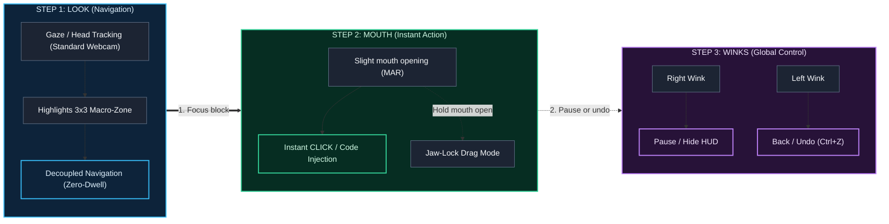

<div align="center">

# IDEye (Vistax L2C Engine)
**The Look-To-Code (L2C) Engine for Hands-Free, Silent Software Engineering**

<p align="right">
  <strong>Language:</strong>
  <b>English</b> | <a href="README.es.md">Español</a>
</p>

[](https://www.python.org/)
[](https://github.com/danicaju/IDEye/releases)
[](https://developers.google.com/mediapipe)
[](https://www.riverbankcomputing.com/software/pyqt/)
[](#-testing--qa)
[](LICENSE)

*Write real production code using only a standard webcam, hybrid gaze tracking, and discrete facial gestures. No hands. No voice commands. No expensive infrared hardware.*

[Quick Downloads](#-pre-built-releases--quick-downloads) • [How It Works](#-how-it-works-3-step-interaction) • [Core Innovations](#-core-innovations) • [Quick Start](#-quick-start) • [Controls & Shortcuts](#-runtime-controls--shortcuts) • [Architecture](#-system-architecture) • [Roadmap](#-roadmap)

---

</div>

> [!TIP]
> **Just want to use IDEye without installing Python or touching a terminal?**
>
> Download the pre-compiled portable bundle and the official VS Code companion extension directly from **[GitHub Releases](https://github.com/danicaju/IDEye/releases)**:
> - **`IDEye-Windows-v0.5.0.zip`** — Standalone Windows desktop app (unzip and double-click `IDEye.exe`).
> - **`ideye-vscode-bridge-0.5.0.vsix`** — Native VS Code companion extension (drag & drop directly into your VS Code window).

---

## The Problem & Why IDEye Exists

Developers experiencing severe RSI, carpal tunnel, motor disabilities, or temporary injuries face major barriers when coding:
1. **Voice-coding tools (Talon, Cursorless)** require constant vocalization, which fails in shared offices, libraries, late-night sessions, or for developers with speech impairments.
2. **On-screen keyboards (OptiKey)** force letter-by-letter typing and practically require $300–$1,000 specialized infrared hardware (Tobii) due to webcam jitter.
3. **Webcam mouse drivers (Project Gameface, eViacam)** only move the OS cursor, suffering from the painful *"Midas Touch" problem* (dwelling fatigue).

**IDEye (Vistax)** solves this from first principles: combining a **3x3 Macro-Zone AST HUD**, **hybrid head+iris webcam tracking**, **instant zero-dwell facial gesture triggers**, **bidirectional VS Code WebSocket integration**, and **live AST context prediction**.

### State-of-the-Art Comparison

| Feature / Capability | Standard Webcam ($0) | 100% Silent (No Voice) | AST / Macro Code Injection | Live Local Variable Awareness | Bidirectional VS Code WebSocket | 60 Hz FreeLook & Gaming |
| :--- | :---: | :---: | :---: | :---: | :---: | :---: |
| **Talon Voice / Cursorless** | No | No | Yes | Yes | No | No |
| **OptiKey** | Partial *(IR Rec.)* | Yes | No *(Char-by-char)* | No | No | No |
| **Google Project Gameface** | Yes | Yes | No *(Mouse driver)* | No | No | Yes |
| **IDEye (Vistax L2C)** | **Yes** | **Yes** | **Yes (3x3 Macro-HUD)** | **Yes (AST + AI)** | **Yes** | **Yes** |

---

## How It Works: 3-Step Interaction



---

## Core Innovations

The system is structured across four foundational architectural pillars:

### 1. Sub-Pixel Hybrid Tracking & Cranial Centroid
Standard webcam pupil tracking lacks dynamic range at normal monitor distances. IDEye fuses the normalized iris offset with the 3D nose-tip anchor vector:
$$\mathbf{P}_{raw} = \alpha_{head} \cdot \mathbf{V}_{nose} + (1 - \alpha_{head}) \cdot \mathbf{V}_{iris}$$
Weighted cranial landmarks from MediaPipe FaceMesh (`[1, 4, 6, 168, 195, 197]`) with an adaptive hysteresis gate (`STATIC_LOCK_RADIUS=0.0035`, `0.0px` drift) eliminate micro-tremor during fixations without adding latency to saccades. Includes cap/visor resilience and low-light Eye ROI CLAHE compensation.

### 2. Zero-Dwell Midas Elimination & Biometric Gestures
Navigation and activation are completely decoupled: looking only highlights, never clicks. A slight mouth opening (Mouth Aspect Ratio, MAR) performs an instant click or snippet injection. Holding the mouth open enters **Jaw-Lock** drag mode. An **adaptive resting-MAR baseline** continuously learns the user's resting posture, preventing ghost clicks and dwelling fatigue. Independent winks handle instant Undo (left wink) and Pause/Hide (right wink).

### 3. Bidirectional VS Code WebSocket Bridge & Fault-Tolerant Live AST
The `WebSocketBridge` synchronizes editor diagnostics, active selections, and syntax trees in real time (`ws://127.0.0.1:54321`). `ContextReader` extracts local variables, signatures, and imports even when code has syntax errors (`ast.walk` + regex fallback). Features **6 operating modes**: `CODING`, `WRITING` (letter keyboard with word predictions), `TERMINAL_GIT`, `DATA_MATH`, `NAVIGATION`, and `FREELOOK_GAMING` (60 Hz head-joystick with central deadzone).

### 4. Non-Intrusive PyQt6 HUD, Ergonomics & Multi-Monitor
The HUD runs via PyQt6 with `WindowDoesNotAcceptFocus` and native `WS_EX_TRANSPARENT`, allowing OS clicks to pass through without stealing keyboard focus or editor cursor state. Supports **Right Dock layout** (30% column), **Ghost Mode** (auto-dims to 15% opacity while reading), **Multi-Monitor gaze handover**, and procedural offline sound synthesis via `numpy` and native `winsound`.

---

## Quick Start

### Pre-Built Releases & Quick Downloads (Recommended for End-Users)
1. **Download `IDEye-Windows-v0.5.0.zip`** from **[GitHub Releases](https://github.com/danicaju/IDEye/releases)** and extract it.
2. **Launch `IDEye.exe`** (pre-bundled with Python, OpenCV, MediaPipe, and PyQt6 runtimes).
3. **Install the Companion VS Code Extension**: Drag `ideye-vscode-bridge-0.5.0.vsix` into VS Code.
4. **Code hands-free**: Your webcam calibrates automatically and connects to VS Code over local WebSocket.

### Developer Installation (Build from Source)
```bash
# 1. Clone the repository
git clone https://github.com/danicaju/IDEye.git
cd IDEye

# 2. Set up virtual environment
python -m venv venv
venv\Scripts\activate      # On Linux/macOS: source venv/bin/activate

# 3. Install dependencies & launch
pip install -r requirements.txt
python main.py
```

---

## Runtime Controls & Shortcuts

### Essential Everyday Controls

| Action | Input / Shortcut | Description |
| :--- | :--- | :--- |
| **Emergency Killswitch** | **`Ctrl+Alt+Q`** | Global OS-wide hotkey: immediately shuts down IDEye from anywhere |
| **Emergency Reset** | **`Ctrl+Alt+R`** | Immediately clears calibration weights and resets to neutral mapping |
| **Pause / Reading Mode** | **`Ctrl+Alt+P`** / **Right Wink** | Hides the HUD completely so you can read code without clicks |
| **Snap to Caret** | **`C`** | 1-point micro-recalibration centering gaze to the active editor cursor |
| **Toggle Right Dock** | **`D`** | Toggles between Full Grid (100%) and Right Dock (30% column, 460px width) |
| **Inject / Click** | **Mouth Click** | Short mouth opening (MAR) triggers instant zero-dwell click or injection |
| **Drag / Jaw-Lock** | **Held Mouth** | Holding mouth open engages adaptive drag mode without timer fatigue |
| **Universal Undo** | **`Z`** / **Left Wink** | Navigates back in menus or sends instant Undo (Ctrl+Z) |

<details>
<summary><b>View all 34 shortcuts, mode controls & gaming mappings</b></summary>

<br>

| Key | Action | Description |
| :--- | :--- | :--- |
| **`Ctrl+Alt+A`** | **Toggle Smart Menus** | Auto-adapts 9 HUD blocks to function signatures, try blocks, and loops |
| **`Ctrl+Alt+B`** | **Clipboard History** | Opens the last 6 user copies in a 3x3 grid for instant re-injection |
| **`Ctrl+Alt+L`** | **Change Language** | Cycles Python, TypeScript, Rust, C++, Go syntax definitions |
| **`Ctrl+Alt+V`** | **Open Mode Selector** | Opens the 6-mode switcher anywhere in the OS |
| **`Ctrl+Alt+K`** | **Toggle Auto-Switching**| Enables/disables automatic mode routing based on editor context |
| **`Ctrl+Alt+F`** | **FreeLook Mode** | Grid-free 60 Hz mouse gaze navigation with top magnetic command bar |
| **`Edge Scroll`** | **Web Scroll** | Rest gaze on top/bottom display edge for ~0.3 s to scroll |
| **`Ctrl+Alt+G`** | **Gaming Mode** | Head-joystick for WASD movement; left wink jumps; right wink toggles cursor |
| **`Ctrl+Alt+S`** | **Toggle Audio** | Enables/disables procedural audio feedback |
| **`Ctrl+Alt+H`** | **Help & Gesture Guide**| Opens in-app gesture cheatsheet and calibration modal |
| **`Ctrl+Alt+T`** | **Cycle Tracking Mode** | Cycles `HEAD_PRIMARY`, `PURE_IRIS`, and `HYBRID` tracking algorithms |
| **`Ctrl+Alt+C`** | **Center Calibration** | Look at screen center and press to reset neutral anchor |
| **`Ctrl+Alt+M`** | **Toggle Mini-Feed** | Shows/hides real-time tracking metrics and camera monitor panel |
| **`Ctrl+Alt+N`** | **Multi-Monitor Handover**| Moves the HUD and gaze bounds to the next display |
| **`Ctrl+Alt+Z`** | **Sniper Lens x3.5** | Activates precision zoom lens and slow-motion in FreeLook |
| **`Ctrl+Alt+J`** | **Semantic AST Jump** | Opens 3x3 symbol map for active file and teleports caret |
| **`Ctrl+Alt+I`** | **Agentic Prompt Launcher**| Opens 6 engineering prompts for VS Code chat or local MCP queue |
| **`Ctrl+Alt+W`** | **Inertial Gaze Scroll** | Proportional vertical/horizontal wheel with deadzone and soft braking |
| **`P`** | **Gaze Spotlight** | Opens the 3x3 Gaze Command Palette modal |
| **`O`** | **Toggle Theme** | Cycles between Cyber Glass, OLED Black (WCAG AAA), and Solarized Dark |
| **`F2`** | **Mini-Tutorial** | In-app 3-step interactive onboarding guide |
| **Eye Exit** | **[X EXIT] Hands-Free** | Gaze at top-right `[X EXIT]` and mouth-click for eye-accessible exit dialog |

</details>

---

## System Architecture

```text
+-------------------------------------------------------------------------+
| CAMERA TRACKER (QThread)                                                |
| OpenCV Capture -> MediaPipe FaceMesh (478 pts) -> Iris + Cranial Centroid|
+------------------------------------+------------------------------------+
 | pyqtSignal(x, y)                  | pyqtSignal("GESTURE")
 v                                   v
+-------------------------------------------------------------------------+
| PYQT6 NO-FOCUS OVERLAY (Main GUI)                                       |
| [0: FLOW] [1: FUNC/CLASS] [2: OPERATORS]                                |
| [3: CURSOR] [4: PAUSE] [5: KEYWORDS]                            |
| [6: EDIT/UNDO] [7: ENTER/TAB] [8: AI PREDICTOR]                         |
+------------------------------------+------------------------------------+
 |                                   |
 v                                   v
+-------------------------------+  +--------------------------------------+
| MODE MANAGER & VS CODE BRIDGE |  | CONTEXT & AI ENGINE (QThread)        |
| - CODING / WRITING / TERMINAL |  | - Live AST + Regex Symbol Parse      |
| - DATA / NAVIGATION / FREELOOK|  | - Async Ollama / OpenAI Client       |
| - GAMING                      |  | - Zero-Latency Heuristic Fallback    |
+-------------------------------+  +--------------------------------------+
 |                                   |
 v                                   v
+-------------------------------+  +--------------------------------------+
| CODE INJECTOR ENGINE          |  | PROCEDURAL SOUND ENGINE              |
| - Clipboard Atomic Swap       |  | - numpy WAV synthesis                |
| - Cursor Offset Reposition    |  | - Async winsound / offline cache     |
+-------------------------------+  +--------------------------------------+
 |
 v
+---------------------------------+
| TARGET IDE (VS Code, etc.)      |
+---------------------------------+
```

---

## Project Structure

```text
IDEye/
├── main.py                          # Root launcher (`python main.py`)
├── config.py                        # Central configuration defaults
├── requirements.txt                 # Dependencies (MediaPipe, PyQt6, OpenCV, numpy)
├── build_app.py                     # Standalone PyInstaller onedir builder
├── IDEye.bat / IDEye.vbs            # Windows quick / silent launchers
├── docs/guia_interactiva.html       # Self-contained offline Interactive Guide
├── vscode-extension/                # Official VS Code WebSocket companion extension
├── ideye/
│   ├── core/                        # Tracking, biometrics, audio, and WebSocket bridge
│   ├── modes/                       # 6-mode strategy engine (Coding, Writing, Gaming...)
│   ├── ui/                          # Transparent PyQt6 overlay, calibration & icons
│   ├── actions/                     # AST extractor, AI predictor, and code injector
│   └── assets/                      # High-DPI neon SVG icons & word prediction data
└── tests/                           # 42 automated test suites (702 tests, hardware-mocked)
```

---

## Testing & QA

IDEye features an automated hardware-mocked test suite covering mathematical edge cases, recursive menu tree integrity, AST fault tolerance, and gaze stability:

```bash
pytest -q
```
```text
702 passed, 89 subtests in 22.15s
```

> [!NOTE]
> All 702 tests execute headlessly without requiring a physical webcam, display server, or network connection.

---

## Roadmap

### Current Version (`v0.5.0`)
- [x] Full production release: standalone Windows portable bundle + native VS Code extension.
- [x] 6-mode strategy engine with automated WebSocket context detection.
- [x] Adaptive resting MAR baseline (anti-Midas protection) and 60 Hz FreeLook gaming.

### Upcoming Milestones
- [ ] Native Linux Wayland overlay backend (`wlr-layer-shell` support).
- [ ] macOS Apple Silicon universal binary packaging.
- [ ] On-device quantized local eye-model acceleration with ONNX Runtime.

<details>
<summary><b>Historical Engineering Roadmap (Phases 1–12.1 Completed)</b></summary>

<br>

- [x] **Phase 1:** Hybrid Iris + Head tracking with EMA smoothing & MAR mouth-click trigger.
- [x] **Phase 2:** PyQt6 `WindowDoesNotAcceptFocus` transparent HUD & 5-point JSON calibration.
- [x] **Phase 3:** 3x3 Hierarchical syntax trees & atomic clipboard code injection with cursor offsets.
- [x] **Phase 4:** Live AST/Regex symbol extraction & asynchronous AI/Heuristic code prediction.
- [x] **Phase 5:** Multi-language syntax trees (TypeScript, Rust, C++, Go) & native VS Code WebSocket extension.
- [x] **Phase 6:** 6-mode strategy engine (Coding, Writing, Terminal, Data, Navigation, FreeLook/Gaming).
- [x] **Phase 6.5 - 6.6:** Glass & Focus HUD, high-DPI Lucide icons, and help modal layout.
- [x] **Phase 7 - 7.9:** Procedural numpy audio, FreeLook 60 Hz, Jaw-Lock drag, and sub-pixel cranial centroid.
- [x] **Phase 8.1 - 8.4:** Persistent user settings, custom macro builder, multi-monitor gaze handover, and CI matrix.
- [x] **Phase 9 - 9.6:** Clipboard time-machine, OS window routing, diagnostics Auto-Fix, and Health Guard.
- [x] **Phase 10 - 11:** Adaptive CLAHE low-light, Semantic AST Jump, dynamic game profiles, and inertial gaze scroll.
- [x] **Phase 12 - 12.1:** Deep semantic coding taxonomy, interactive tutorial onboarding, and adaptive resting MAR engine.

</details>

---

## Privacy, Safety & Legal Disclaimers

- **100% Local Biometric Processing**: All webcam video frames and 3D facial landmarks are processed exclusively in volatile local RAM. IDEye never records, stores, or transmits biometric data over any network.
- **Ergonomic Notice**: IDEye is an assistive productivity tool, not a certified medical device. Users should take regular breaks to avoid facial or cervical fatigue.
- **Online Gaming Notice**: Gaming Mode uses OS-level synthetic input injection (`Win32 API` / `pynput`) for accessibility. Verify compatibility before using in competitive multiplayer games with kernel-level anti-cheat.

---

## Contributing & License

IDEye is distributed under the terms of the **GNU Affero General Public License v3.0 (AGPL-3.0-or-later)**. Any modification, redistribution, or deployment as a network service must remain open source under the same license.

<div align="center">
  <sub>Developed by <b>Daniel Casado Juan</b> &middot; Universitat de les Illes Balears (UIB)</sub>
</div>
